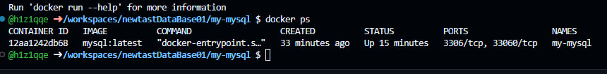
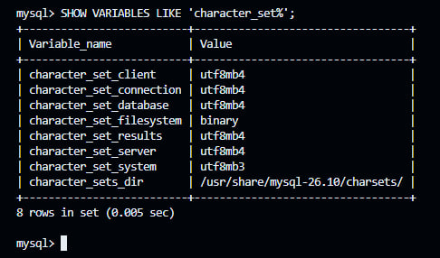
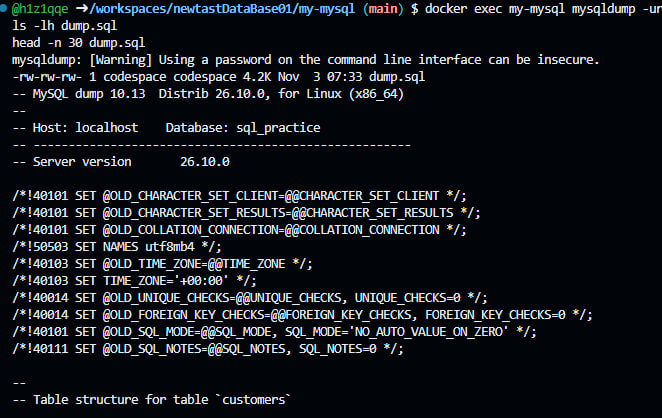
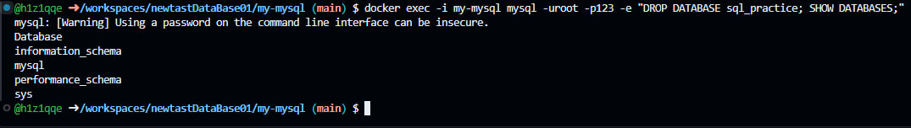
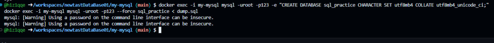

# MySQL в изолированном окружении Docker (InnoDB)


Учебный проект: полный цикл работы с MySQL в Docker-контейнере — запуск «чистого» окружения, SQL-практика (DDL/DML/JOIN/агрегаты/ALTER), резервное копирование через `mysqldump`, удаление базы и восстановление из дампа.

> Выполняется в **GitHub Codespaces**. Время выполнения: ~20–30 минут.

---

## Содержание

1. [Подготовка: конфиг my.cnf](#шаг-1-подготовка-конфиг-my-cnf)
2. [Запуск контейнера](#шаг-2-запуск-контейнера)
3. [Подключение к MySQL](#шаг-3-подключение-к-mysql)
4. [База данных и таблицы](#шаг-4-база-данных-и-таблицы)
5. [Данные и запросы](#шаг-5-данные-и-запросы)
6. [Изменение структуры (ALTER)](#шаг-6-изменение-структуры-alter)
7. [Дамп базы данных](#шаг-7-дамп-базы-данных)
8. [Удаление и восстановление](#шаг-8-удаление-и-восстановление)
9. [Финальная проверка](#шаг-9-финальная-проверка)
10. [Шпаргалка: bash vs mysql](#шпаргалка-bash-vs-mysql)
11. [Если что-то пошло не так](#если-что-то-пошло-не-так)
12. [Как прикрепить скриншоты](#как-прикрепить-скриншоты)

---

## Шаг 1. Подготовка: конфиг my.cnf

В терминале Codespace создайте папку проекта и файл конфигурации (нужен для корректной работы с кириллицей):

```bash
mkdir -p my-mysql && cd my-mysql
cat > my.cnf << 'EOF'
[mysqld]
character-set-server = utf8mb4
collation-server     = utf8mb4_unicode_ci

[client]
default-character-set = utf8mb4

[mysql]
default-character-set = utf8mb4
EOF
chmod 644 my.cnf
```

`chmod 644` обязателен: иначе MySQL проигнорирует файл (предупреждение *World-writable config file*).

---

## Шаг 2. Запуск контейнера

```bash
docker run --name my-mysql \
  -e MYSQL_ROOT_PASSWORD=123 \
  -e LANG=C.UTF-8 \
  -v mysql_data:/var/lib/mysql \
  -v $(pwd)/my.cnf:/etc/mysql/conf.d/my.cnf \
  -d mysql:latest
```

Что делают параметры:

| Параметр | Назначение |
|---|---|
| `--name my-mysql` | имя контейнера |
| `-e MYSQL_ROOT_PASSWORD=123` | пароль root |
| `-v mysql_data:/var/lib/mysql` | данные живут в named volume — переживут удаление контейнера |
| `-v $(pwd)/my.cnf:...` | наш конфиг внутри контейнера |
| `-d` | запуск в фоне |

Проверка, что контейнер работает (подождите ~20 секунд — первый запуск инициализирует базы):

```bash
docker ps
```

> ### 📸 Скриншот №1 — контейнер запущен
> **Что в кадре:** вывод `docker ps` со строкой `my-mysql` и статусом `Up`.



---

## Шаг 3. Подключение к MySQL

```bash
docker exec -it my-mysql mysql --default-character-set=utf8mb4 -uroot -p
```

Пароль: `123`. Приглашение сменится с `@h1z1qqe ➜ ...$` на `mysql>` — теперь можно вводить SQL.

| Приглашение | Где вы | Что работает |
|---|---|---|
| `@h1z1qqe ➜ ...$` | bash (терминал Codespace) | `docker ...`, `ls`, `cat` |
| `mysql>` | клиент MySQL | только SQL-команды, выход — `\q` |

Проверим, что кодировка применилась:

```sql
SHOW VARIABLES LIKE 'character_set%';
```

Все `character_set_*` должны быть `utf8mb4` (значения `character_set_system = utf8mb3` и `character_set_filesystem = binary` — норма).

> ### 📸 Скриншот №2 — кодировка utf8mb4
> **Что в кадре:** вывод `SHOW VARIABLES LIKE 'character_set%'` со значениями `utf8mb4`.



---

## Шаг 4. База данных и таблицы

Внутри `mysql>`:

```sql
CREATE DATABASE sql_practice CHARACTER SET utf8mb4 COLLATE utf8mb4_unicode_ci;
USE sql_practice;

CREATE TABLE customers (
    id INT AUTO_INCREMENT PRIMARY KEY,
    name VARCHAR(100) NOT NULL,
    email VARCHAR(100) NOT NULL UNIQUE,
    city VARCHAR(100),
    created_at TIMESTAMP DEFAULT CURRENT_TIMESTAMP
) CHARACTER SET utf8mb4 COLLATE utf8mb4_unicode_ci;

CREATE TABLE orders (
    id INT AUTO_INCREMENT PRIMARY KEY,
    customer_id INT NOT NULL,
    order_date DATE NOT NULL,
    amount DECIMAL(10, 2) NOT NULL,
    status VARCHAR(20) DEFAULT 'new',
    FOREIGN KEY (customer_id) REFERENCES customers(id)
) CHARACTER SET utf8mb4 COLLATE utf8mb4_unicode_ci;

SHOW TABLES;
```

---

## Шаг 5. Данные и запросы

Наполнение:

```sql
INSERT INTO customers (name, email, city) VALUES
('Иван Иванов',      'ivanov@mail.ru',     'Москва'),
('Пётр Петров',      'petrov@mail.ru',     'Санкт-Петербург'),
('Мария Сидорова',   'sidorova@mail.ru',   'Москва'),
('Алексей Смирнов',  'smirnov@mail.ru',    'Казань'),
('Ольга Кузнецова',  'kuznetsova@mail.ru', 'Новосибирск');

INSERT INTO orders (customer_id, order_date, amount, status) VALUES
(1, '2026-10-01', 1500.00, 'paid'),
(1, '2026-10-03', 2500.50, 'paid'),
(2, '2026-10-05',  800.00, 'new'),
(3, '2026-10-08', 4200.00, 'paid'),
(3, '2026-10-10', 1200.75, 'new'),
(4, '2026-10-12',  990.00, 'cancelled');
```

CRUD и фильтры:

```sql
UPDATE orders SET status = 'paid' WHERE id = 3;
DELETE FROM orders WHERE id = 6;

SELECT * FROM customers;
SELECT * FROM customers WHERE city = 'Москва' ORDER BY name;
SELECT * FROM orders WHERE amount BETWEEN 1000 AND 3000 ORDER BY amount DESC;
```

JOIN и агрегаты:

```sql
SELECT c.name, o.amount, o.status
FROM customers c
JOIN orders o ON c.id = o.customer_id;

SELECT c.name, COUNT(*) AS orders_count, SUM(o.amount) AS total
FROM customers c
JOIN orders o ON c.id = o.customer_id
GROUP BY c.name
HAVING total > 1000;
```

---

## Шаг 6. Изменение структуры (ALTER)

```sql
ALTER TABLE customers ADD COLUMN phone VARCHAR(20);
UPDATE customers SET phone = '123-45-67' WHERE id = 1;

ALTER TABLE customers MODIFY COLUMN phone VARCHAR(30);
ALTER TABLE customers DROP COLUMN phone;

SELECT * FROM customers;
```

---

## Шаг 7. Дамп базы данных

Выйдите из MySQL (`\q`) — дальше работаем **в bash**:

```bash
docker exec my-mysql mysqldump -uroot -p123 --set-gtid-purged=OFF sql_practice > dump.sql
ls -lh dump.sql
head -20 dump.sql
```

Флаг `--set-gtid-purged=OFF` исключает служебную GTID-строку, из-за которой восстановление на том же сервере падает с `ERROR 3546`.

> ### 📸 Скриншот №3 — дамп создан
> **Что в кадре:** команда `mysqldump ...`, вывод `ls -lh dump.sql` с размером файла и первые строки дампа (`head`).



---

## Шаг 8. Удаление и восстановление

Удаляем базу целиком:

```bash
docker exec -i my-mysql mysql -uroot -p123 -e "DROP DATABASE sql_practice; SHOW DATABASES;"
```

Восстанавливаем из дампа:

```bash
docker exec -i my-mysql mysql -uroot -p123 -e "CREATE DATABASE sql_practice CHARACTER SET utf8mb4 COLLATE utf8mb4_unicode_ci;"
docker exec -i my-mysql mysql -uroot -p123 --force sql_practice < dump.sql
```

> ### 📸 Скриншот №4 — база удалена
> **Что в кадре:** команда `DROP DATABASE ...` и вывод `SHOW DATABASES` **без** `sql_practice`.



> ### 📸 Скриншот №5 — восстановление из дампа
> **Что в кадре:** команды `CREATE DATABASE ...` и импорт `dump.sql`.



---

## Шаг 9. Финальная проверка

```bash
docker exec -it my-mysql mysql --default-character-set=utf8mb4 -uroot -p
```

```sql
USE sql_practice;
SHOW TABLES;
SELECT COUNT(*) AS customers FROM customers;
SELECT COUNT(*) AS orders FROM orders;
SELECT c.name, o.amount, o.status FROM customers c JOIN orders o ON c.id = o.customer_id;
```

Ожидаемо: таблицы на месте, `customers = 5`, `orders = 5`, данные восстановлены полностью.

Управление контейнером:

```bash
docker stop my-mysql    # остановить
docker start my-mysql   # запустить снова
docker rm -f my-mysql   # удалить контейнер (данные останутся в volume mysql_data)
```

---

## Шпаргалка: bash vs mysql

| Задача | Где | Команда |
|---|---|---|
| Запустить контейнер | bash | `docker run ... -d mysql:latest` |
| Войти в MySQL | bash | `docker exec -it my-mysql mysql -uroot -p` |
| SQL-запросы | `mysql>` | `SELECT ...;` |
| Дамп | bash | `docker exec my-mysql mysqldump ...` |
| Восстановление | bash | `docker exec -i my-mysql mysql ... < dump.sql` |
| Выход | `mysql>` | `\q` |

## Если что-то пошло не так

| Симптом | Причина | Решение |
|---|---|---|
| `bash: UPDATE: command not found` | SQL вставлен в bash вместо mysql | войдите в `mysql>` и повторите |
| `ERROR 1007: Can't create database ... database exists` | база уже существует | пропустите CREATE или сначала `DROP DATABASE` |
| `ERROR 3546: @@GLOBAL.GTID_PURGED cannot be changed` | дамп сделан без флага GTID | пересоздайте дамп с `--set-gtid-purged=OFF` |
| `Warning: World-writable config file is ignored` | права на my.cnf 666 | `chmod 644 my.cnf && docker restart my-mysql` |
| Кракозябры вместо русских букв | не задана кодировка клиента | добавьте `--default-character-set=utf8mb4` |
| `Can't connect... through socket` | MySQL ещё инициализируется | подождите 20–30 сек, проверьте `docker logs my-mysql` |

## Как прикрепить скриншоты

Создайте папку рядом с этим README и сохраните снимки с точными именами:

```
screenshots/
├── 01-containers.jpg   — docker ps: контейнер my-mysql
├── 02-charset.jpg      — проверка кодировки utf8mb4
├── 03-dump.jpg         — mysqldump и размер файла
├── 04-drop.jpg         — DROP DATABASE
└── 05-restore.jpg      — восстановление из dump.sql
```

Затем закоммитьте и запушьте — GitHub отрисует снимки прямо в README:

```bash
git add README.md screenshots
git commit -m "MySQL Docker lab: отчёт со скриншотами"
git push
```
